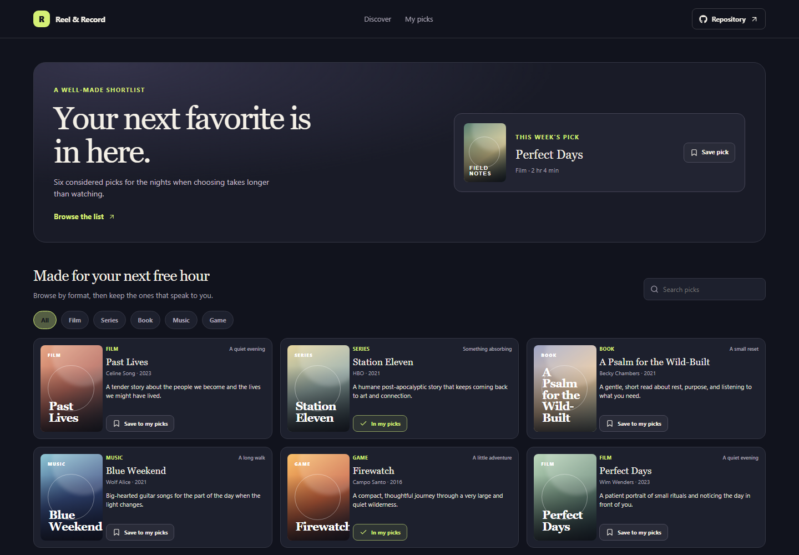

# Media Recommendation Board

Reel & Record is a personal shortlist for finding a film, series, book, album, or game that fits the time and mood you have.

**Live site:** [https://a2rp.github.io/media-recommendation-board/](https://a2rp.github.io/media-recommendation-board/)

## Interface

The page opens with a weekly featured pick, then a searchable recommendation grid and a My picks list. Format filters narrow the grid to films, series, books, music, or games.

## Features and use

Choose a format or search by title, creator, mood, or description. Select Save to my picks on a card to keep it in the lower collection. Select In my picks again to remove it. The featured card can be saved in the same way.

## Data and limits

The recommendation catalog is built into the app. Saved pick IDs are stored in localStorage in this browser. The app does not stream media or create accounts.

## Run locally

Use Node.js and npm, then run these commands from the project folder:

```sh
npm install
npm run dev
```

Run ESLint and create a production build with:

```sh
npm run lint
npm run build
```

## Deployment

The public app is published with GitHub Pages. Build and publish the current version with:

```sh
npm run deploy
```

Vite builds with the /media-recommendation-board/ project-page base path.

## Future improvements

These are ideas and are not implemented yet:

- Add editable recommendations and custom mood labels.
- Offer a shareable export of a saved shortlist.

## Links

- Portfolio: [https://www.ashishranjan.net](https://www.ashishranjan.net)
- GitHub: [https://github.com/a2rp](https://github.com/a2rp)
- CodePen: [https://codepen.io/ash1198](https://codepen.io/ash1198)
- LinkedIn: [https://www.linkedin.com/in/aashishranjan](https://www.linkedin.com/in/aashishranjan)
- Facebook: [https://www.facebook.com/theash.ashish/](https://www.facebook.com/theash.ashish/)
- YouTube: [https://www.youtube.com/@ashishranjan-ashz?sub_confirmation=1](https://www.youtube.com/@ashishranjan-ashz?sub_confirmation=1)
- Email: [mailto:ash.ranjan09@gmail.com](mailto:ash.ranjan09@gmail.com)

## Support

- Support: [https://a2rp-donation-page.netlify.app/](https://a2rp-donation-page.netlify.app/)
- Buy Me a Coffee: [https://buymeacoffee.com/ashishranjan](https://buymeacoffee.com/ashishranjan)
- Patreon: [https://www.patreon.com/ashishranjan](https://www.patreon.com/ashishranjan)